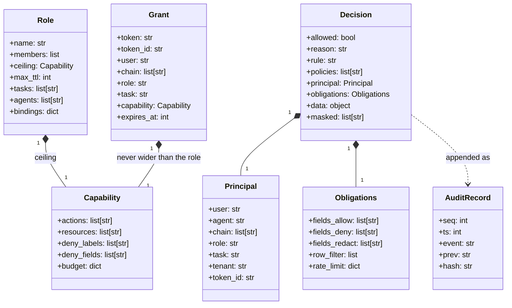
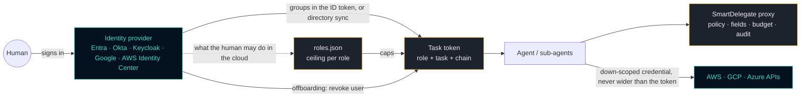
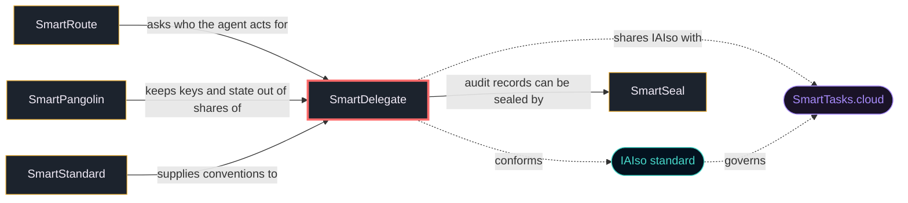

<!-- mcp-name: io.github.smarttasksorg/sf-smartdelegate -->
<h1 align="center">🦔 SmartDelegate</h1>
<p align="center"><b>Delegate, don't hand over the keys. An agent never holds more than the human's role for the task.</b></p>
<p align="center">
  <a href="https://iaiso.org">IAIso §10 · Delegation</a> ·
  <a href="https://smarttasks.cloud">SmartTasks.cloud</a> ·
  <a href="#part-of-the-smart-family">the Smart* family</a>
</p>

---

## Your agent is running on your API key. What exactly can it do right now?

Usually: everything you can, on every record, until someone rotates the key.
**SmartDelegate** is identity and access management for LLM agents. A human lends
an agent **one role they hold, for one task**. The agent gets a short-lived token
that can never carry more than that role allows, a sub-agent can only get less,
every tool call is checked, fields the human's role may not see are removed before
they reach the model, and every decision lands in a hash-chained audit log.

```bash
pip install sf-smartdelegate    # from a clone: pip install .
sf-smartdelegate --demo         # nine steps against the bundled example, no setup
```

Lines from its output (shortened):

```text
1. Alice (support) lends support-bot her support-agent role for ticket-7
2. The bot reads customer c-1: DELEGATE-POLICY-PERMIT
   removed before it reached the model: ['card.number', 'notes', 'ssn']
4. A second 60.00 EUR refund on the same task: DELEGATE-BUDGET-EXCEEDED (...)
5. Alice asks for more than her role allows (a 500 EUR budget)
   refused: DELEGATE-ROLE-EXCEEDED (...)
6. The bot hands a read-only slice to a sub-agent
   and cannot widen it again: DELEGATE-WIDENING
8. The identity provider says Alice left the support group five minutes ago
   refused: DELEGATE-ROLE-NOT-HELD (live membership replaces the stored one)
```

> **Status: 0.3.0. No independent security review. Built and tested on Linux only.**
> Read [docs/LIMITATIONS.md](docs/LIMITATIONS.md) before relying on it.

## Run it in your stack

| Where you work | How you run it |
|---|---|
| **Python** (reference) | `pip install sf-smartdelegate`: engine, CLI, REST daemon, HTTP proxy, MCP proxy, SQL guard, IAM bridges |
| **Java · Node · Go · PHP · Rust** | native engines in [`ports/`](ports/), each with a CLI and REST daemon, each held to the same vectors and checked against every other port by [`ports/conformance/matrix.py`](ports/conformance/matrix.py) |
| **Browser / Deno / any JS** | REST client in [`ports/js`](ports/js/) |
| **Any other language** | `sf-smartdelegate serve` and the REST API in [`spec/openapi.yaml`](spec/openapi.yaml); C ABI in the Rust port |
| **LangChain · LlamaIndex · OpenAI/Anthropic tools · MCP · Flowise · VS Code · GitHub Actions** | wrappers in [`integrations/`](integrations/); the Python ones share one `adapter.py` |
| **AWS · Azure / Entra · Google Cloud · Okta · Keycloak · Auth0 · any OIDC + SCIM** | [`sf_smartdelegate.bridges`](src/sf_smartdelegate/bridges/): see [docs/BRIDGES.md](docs/BRIDGES.md) |
| **CI / pre-commit** | hooks in [`.pre-commit-hooks.yaml`](.pre-commit-hooks.yaml) |

## Thirty seconds of code

```python
from sf_smartdelegate import core

iam = core.open_engine("bundle", "state")

# the human lends the agent a role they hold, for one task
grant = core.delegate(iam, user="alice", agent="support-bot", role="support-agent", task="ticket-7")

# every tool call is checked; the data comes back already masked
d = core.check(iam, grant.token, "read", "crm.customer", "c-1", data=record)
if d.allowed:
    give_to_model(d.data)          # no ssn, no internal notes
else:
    print(d.rule, d.detail)        # e.g. DELEGATE-CAPABILITY-ACTION

# a sub-agent gets less, never more
child = core.narrow(iam, grant, actor="summarizer", capability={"actions": ["read"], "resources": ["crm.customer/c-1"]})
```

More in [examples/usage.md](examples/usage.md).

## Install

```bash
python -m pip install sf-smartdelegate
sf-smartdelegate --demo
```

Every file of `sf-smartdelegate` on PyPI is built and published by this repository's
release workflow (`.github/workflows/release.yml`, PyPI trusted publishing) and carries
a provenance attestation that names this repository and that workflow; PyPI shows it
under "Verified details". The same workflow records a GitHub attestation for the same
files, which you can check with
`gh attestation verify <file> --repo SmartTasksOrg/sf-smartdelegate`. A release file
without that provenance is not ours.

Version 0.3.0 (published 2026-10-09) is the first release under this name.

To install from a clone instead (Python 3.10 or later):

```bash
git clone https://github.com/SmartTasksOrg/sf-smartdelegate
cd sf-smartdelegate
python -m venv .venv
. .venv/bin/activate          # Windows PowerShell: .\.venv\Scripts\Activate.ps1
python -m pip install .
```

A package called `smartdelegate` (without `sf-`) on any registry is not ours.
The ports in `ports/` are not published on any registry; build them from this
repository (`ports/README.md`).

## Status

- **Version 0.3.0, experimental.** An authorization engine for LLM agents (Python reference with REST daemon, HTTP and MCP proxies) and native ports in five other languages, held to shared conformance vectors.
- **Published:** PyPI `sf-smartdelegate` (see Install). Nothing else is published.
- **Tested:** the tests in `tests/`, the scenario harness (`python -m harness run`) and the skills check on Python 3.10 and 3.12, Linux, on every push to master and every pull request (`.github/workflows/ci.yml`). The ports, the live suites (`live/`) and the cross-port matrix are run by hand (`./bootstrap.sh --full`, `docs/BUILD.md`).
- **Not tested:** Windows and macOS on GitHub runners; the ports and live suites in CI; Docker images; identity providers and clouds other than Keycloak (the bridges are tested against fakes).
- **Ports:** Rust, Go, Java, Node and PHP engines and a JavaScript REST client in `ports/`; none is published on a registry.
- **Security review:** none independent. Report vulnerabilities as described in [SECURITY.md](SECURITY.md).

## What's in this repo

- **Specification**: [`spec/`](spec/): the operations ([API.md](spec/API.md)), roles ([ROLES.md](spec/ROLES.md)), byte formats and porting guide ([PORTING.md](spec/PORTING.md)), the portable Cedar subset, and the conformance vectors every implementation must pass.
- **Reference engine**: [`src/sf_smartdelegate/`](src/sf_smartdelegate/): Python, one dependency (`cryptography`).
- **Language ports**: [`ports/`](ports/): Java, Node, Go, PHP and Rust engines; a JS REST client. See the [table of ports](ports/README.md).
- **IAM bridges**: directory sync, claim mapping, role ceilings from cloud permissions, and down-scoped cloud credentials. [docs/BRIDGES.md](docs/BRIDGES.md).
- **Integrations**: [`integrations/`](integrations/).
- **Adopter interfaces**: [`interfaces/`](interfaces/): the eight contracts a company implements to plug SmartDelegate into its IAM and agent systems, reference implementations, and a contract test kit (`python -m interfaces.contract`). Start at [docs/INTEGRATE.md](docs/INTEGRATE.md).
- **For agents**: [`AGENTS.md`](AGENTS.md), [`skills/`](skills/), [`agents/`](agents/) and [`llms.txt`](llms.txt). How this control fits a governance framework, IAIso or your own: [docs/FRAMEWORK.md](docs/FRAMEWORK.md).
- **Example company and scenario harness**: [`examples/company/`](examples/company/) is a bundle for a company of seven business units, 35 people and 18 roles. [`harness/`](harness/) plays six business scenarios of that company against an engine, in process or against any port's daemon, and checks each step: expected outcome, no denied field in data, spend within budget, revoked tokens refused, an audit record per decision. `python -m harness run`. It is a small harness; the larger one behind the simulation results below is not in this repository.
- **Also included**: a runnable [`demo/`](demo/), [`examples/`](examples/), the IAIso mapping [`spec/iaiso-map.json`](spec/iaiso-map.json), a browser [`site/playground.html`](site/playground.html), the [scope](docs/SCOPE.md), [coverage](docs/COVERAGE.md), [threat model](docs/THREAT_MODEL.md) and [limitations](docs/LIMITATIONS.md).

## How it works

Three bounds apply at once, and the narrowest wins:

| Bound | Question | Where it lives |
|---|---|---|
| **Held** | Does this human hold the role right now? | group membership: live from the identity provider's token, or from the last directory sync |
| **Ceiling** | What is the most this role may hand to an agent? | `roles.json`: actions, resources, fields never visible, budget, lifetime, allowed tasks and agents |
| **Policy** | May this agent, for this human, in this role, do this to that? | Cedar policies, default deny; `context.iam.role` is available to them |

The token records the whole chain (human → agent → sub-agent), the role and the
task. Each hop can only narrow. Then every request goes through the same checks,
first failure wins:

| Rule | Fires when |
|---|---|
| `DELEGATE-TOKEN-INVALID` · `-EXPIRED` · `-REVOKED` | the token is forged, old, revoked, or its human was offboarded |
| `DELEGATE-UNKNOWN-RESOURCE` · `DELEGATE-UNKNOWN-FIELD` · `DELEGATE-TENANT-MISMATCH` | the resource or field is not in the catalog, or the resource belongs to another tenant |
| `DELEGATE-CAPABILITY-ACTION` · `-RESOURCE` | the token does not carry that action or resource |
| `DELEGATE-NO-MATCHING-PERMIT` · `DELEGATE-POLICY-FORBID` · `DELEGATE-POLICY-ERROR` | no policy permits it, one forbids it, or a forbid could not be evaluated |
| `DELEGATE-OBLIGATION-UNRESOLVED` | a row filter needs a value the request did not supply |
| `DELEGATE-RATE-LIMITED` · `DELEGATE-BUDGET-EXCEEDED` | too many calls, or the spend would exceed any token in the chain |
| `DELEGATE-APPROVAL-REQUIRED` | policy wants a second human; the approval is bound to the exact request and used once |
| `DELEGATE-FIELD-DENIED` | strict mode: the input contains a field this principal may not use |
| `DELEGATE-POLICY-PERMIT` | allowed, with obligations: field mask, row filter |

At issuance: `DELEGATE-ROLE-NOT-HELD`, `DELEGATE-ROLE-EXCEEDED`, `DELEGATE-UNKNOWN-ROLE`, `DELEGATE-ROLE-REQUIRED`,
`DELEGATE-DELEGATION-DENIED`, `DELEGATE-WIDENING`, `DELEGATE-DEPTH-EXCEEDED`.
Rule IDs are namespaced `DELEGATE-*` so output reads kin to the rest of the family
(SmartPangolin's `SEC-*`, SmartRoute's `ROUTE-*`).

In-process checks bind an agent that cooperates. The boundary an agent cannot skip
is a proxy that holds the real credential: `sf-smartdelegate http-proxy` and
`sf-smartdelegate mcp-proxy`. [docs/LIMITATIONS.md](docs/LIMITATIONS.md) says exactly when that holds.

### The data objects (UML)

These are real dataclasses in [`src/sf_smartdelegate/models.py`](src/sf_smartdelegate/models.py):



## Bridges to the IAM you already run

SmartDelegate does not replace your identity provider or cloud IAM. It extends them
to agents, in both directions:



| | Inbound: the human's rights | Outbound: the agent's cloud credential |
|---|---|---|
| **AWS** | Identity Center users and groups; a role ceiling from `iam:SimulatePrincipalPolicy` | `sts:AssumeRole` with a session policy generated from the token, session tags for CloudTrail |
| **Azure / Entra ID** | Graph users and groups, group and app-role claims (overage handled); a ceiling from the RBAC permissions API | On-Behalf-Of request limited to the scopes the token maps to. Azure RBAC has no per-token session policy: say so, and keep the proxy in front |
| **Google Cloud** | Workspace / Cloud Identity directory; a ceiling from `testIamPermissions` | Credential Access Boundary (Cloud Storage only) |
| **Okta · Keycloak · Auth0 · Cognito · any OIDC + SCIM** | group claims, SCIM 2.0 or the provider's API | not applicable |

`sf-smartdelegate bridge sync-okta ... --revoke` rewrites `entities.json` from the
directory and ends the live tokens of everyone who was removed or lost a group.

**Keycloak is verified against a real server** (26.0.7 and 26.8.0: sign-in, group
claims, directory sync, key rotation, and the whole loop from "removed from a
group in Keycloak" to "the agent's tokens are dead": [live/idp](live/idp/)). **Every
other bridge was written from the provider's public documentation and tested
against fakes only**: none has been run against a real AWS, Azure, Google or Okta
account. [docs/BRIDGES.md](docs/BRIDGES.md) lists what is unverified.

## How it is tested

| Check | Result on the last run |
|---|---|
| Policy evaluation, answers from the real Cedar engine | 95 cases, passed by all six engines |
| Engine conformance vectors | 78 cases, 327 steps, passed by all six engines |
| Cross-port matrix: each port's tokens, sub-agent tokens, signed bundles and audit logs checked by every other port | 158 checks, 0 failed |
| One state directory shared by Python, Rust, Go and PHP | spend, revocation, approval and one audit chain |
| Simulation with the full harness, which is not in this repository: 200 agents, 500 scenario instances of 16 scenarios, 3,162 deliberate misbehaviours, checked against an independent model of the company's rules | 0 invariant violations; the same seeded workload gives the same outcome on all six engines' daemons |
| Scenario harness in this repository ([harness/](harness/)): six scripted scenarios of the example company, five checks, no misbehaving agents | 6 scenarios, 75 decisions, 0 violations on the reference engine; the same against the Go and the Java daemon by URL |
| Real identity provider ([live/idp](live/idp/)) | 45 tests against Keycloak 26.0.7 and 26.8.0 |
| Real upstream ([live/upstream](live/upstream/)): PostgreSQL, a separate API process, an MCP server, behind the Python and the Rust proxies | 97 tests; fields, rows, budgets and approvals checked against the database |
| Network boundary ([live/boundary](live/boundary/)): an agent in a kernel network namespace that can reach only the proxy | every bypass attempt fails; needs root on Linux |
| Load ([live/load](live/load/RESULTS.md)) | 0 wrong decisions under overload on all six daemons; numbers from a 2-core machine |

One command from a fresh clone builds and checks everything that has a toolchain
installed: `./bootstrap.sh` (Linux, macOS) or `.\bootstrap.ps1` (Windows); add
`--full` / `-Full` for every suite. [docs/BUILD.md](docs/BUILD.md) has the details,
the Docker files and the CI layout. A missing toolchain is reported as SKIP, never
as PASS.

Not run anywhere yet: Windows and macOS themselves (the PowerShell scripts were
executed with PowerShell 7 on Linux only), any Docker image, the GitHub workflows,
and any identity provider or cloud other than Keycloak.

## Where it sits in the architecture



- **SmartRoute** scores whether a call looks trustworthy; **SmartDelegate** decides what authority the agent holds. Use both.
- The arrows to SmartSeal, SmartPangolin and SmartStandard describe how the tools fit together; no code in this repository calls them.

Open [`site/playground.html`](site/playground.html) to try the delegation rules in a browser, and [`site/flows/`](site/flows/index.html) to watch three scenarios replayed step by step from real engine runs, offline.

## Part of the Smart* family

Same mascot, same manifesto voice, same rule-ID style, all aligned to the
[IAIso standard](https://github.com/SmartTasksOrg/IAIso). Each is an independent, open-source, single-purpose tool:

| Tool | IAIso | What it does |
|---|---|---|
| [SmartRoute](https://github.com/SmartTasksOrg/sf-smartroute) | §5 · Orchestration | Route only what you trust. Gate agents and tools with trust scores and guardrails. |
| [SmartSeal](https://github.com/SmartTasksOrg/sf-smartseal) | §3 · Provenance | Seal what you ship. A signed receipt so anyone can verify what they received. |
| [SmartPangolin](https://github.com/SmartTasksOrg/sf-smartpangolin) | §1 · Secure Sharing | Scan before you share. Stop leaking secrets into AI models, agents, and tools. |
| [SmartStandard](https://github.com/SmartTasksOrg/sf-smartstandard) | §7 · Standards | Standardize before you scale. One shared, auditable convention for AI-assisted work. |
| [SmartCheck](https://github.com/SmartTasksOrg/sf-smartcheck) | §2 · Verification | Check before you sign off. Catch the AI when it's confidently wrong. |
| [SmartPrompt](https://github.com/SmartTasksOrg/sf-smartprompt) | §4 · Context | Lint before you send. Bad prompt in, bad work out — and it's your name on it. |
| [SmartMoat](https://github.com/SmartTasksOrg/sf-smartmoat) | §6 · Workforce | Know your moat. Score the tasks AI can't easily take — and widen them. |
| [SmartFeed](https://github.com/SmartTasksOrg/sf-smartfeed) | §9 · Awareness | Distill the firehose. A tight brief of only what moves your work. |

**Aligned to the standard:** SmartDelegate is built to the IAIso principles as the family's delegation control. "§10 · Delegation" is our working label, not a section the standard has assigned; [docs/FRAMEWORK.md](docs/FRAMEWORK.md) says what is implemented and what is only proposed.
**Open-source edition:** this repo is the single-purpose version, built for any org to integrate into its own architecture. SmartTasks' desktop app and [SmartTasks.cloud](https://smarttasks.cloud) run a more advanced, deeply-integrated implementation of the same IAIso governance — a separate product, not this code bundled.

## Who's behind this

- **Roen Branham** — CEO & AI Strategy Architect · CISSP-certified AI, security & governance architect; author of IAIso and sole inventor of the Z4 Semantic Fabric patent application. [LinkedIn](https://www.linkedin.com/in/roen-branham-167ab29/)
- **Le Vu Tanh** — CTO & Core Engineering Lead · Chief architect of the Cortex engine; large-scale system reliability and low-latency infrastructure — the engineer who ships what gets architected. [LinkedIn](https://www.linkedin.com/in/lee-thanh-76aa8ba0/)

<!-- SMARTTASKS-MODELS:START -->
## Runs on governed local models

An agent on a local model needs the same bounds as one on a hosted model: SmartDelegate works the same with either, and makes no call to any model.

**SmartTasks** publishes governance-validated GGUF builds on Hugging Face, each with a machine-readable **scorecard** (capability tiers, IAIso conformance invariants, OWASP-mapped red-team results, per-file SHA-256).

→ **[SmartTasks on Hugging Face](https://huggingface.co/smarttasks)**
<!-- SMARTTASKS-MODELS:END -->

## Get in touch

- **Companies & enterprises:** [enterprise@smarttasks.cloud](mailto:enterprise@smarttasks.cloud) — we help
  teams integrate SmartDelegate + IAIso into their architecture.
- **The standard:** [IAIso](https://github.com/SmartTasksOrg/IAIso) · [iaiso.org](https://iaiso.org)
- **The product:** [SmartTasks.cloud](https://smarttasks.cloud)

Built by **SmartTasks Lab**. Apache-2.0 ([LICENSE](LICENSE)). Contributions welcome: to add a language, start at [spec/PORTING.md](spec/PORTING.md).
