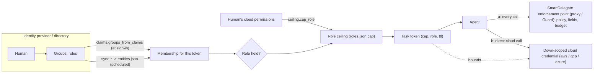

# Bridges: SmartDelegate and AWS, Azure, Google Cloud, Okta, Auth0, Keycloak, SCIM

SmartDelegate bounds an agent by the role a human lends it for one task
(`spec/ROLES.md`). `sf_smartdelegate.bridges` connects that to the identity and
access systems a company already runs, in two directions:

- **Inbound** - who the human is, what they belong to and what they may do
  comes from the identity system, so the agent's bound follows the human's.
- **Outbound** - when the agent must call a cloud API directly, it gets a
  cloud credential that is no wider than the SmartDelegate token it holds.

> **Status. Read this first.** Every adapter in this package was written from
> the provider's public documentation and, with one exception, has been run
> **only against fake servers and hand-written fixtures** in `tests/`. Nothing
> here has been run against a real AWS, Azure, Google, Okta or Auth0 service:
> the development environment could not reach them. Expect to fix details on
> first contact. What was checked in documentation, how, and what was not is
> listed under [What was tested](#what-was-tested-and-what-was-not) and
> [UNVERIFIED](#unverified).
>
> **The exception is Keycloak.** The Keycloak claim preset, the Keycloak
> directory adapter, `bridge sync-keycloak` (with `--revoke` through a running
> daemon) and the engine's own OIDC path were **tested against a real Keycloak
> 26.0.7 on 2026-10-05**, and the same suite passed against 26.8.0 the same
> day. The suite is in [`live/idp/`](../live/idp/README.md) and can be re-run
> with `live/idp/run.sh`. What it found is under
> [Keycloak: verified against the real server](#keycloak-verified-against-the-real-server).

Standard library only. No `boto3`, `google-*`, `azure-*`, `msal` or `requests`
import. Network calls go through an injectable transport; functions meant for
a cloud SDK return plain dicts that you pass to the SDK yourself.

## The model



(a) is the complete bound: capability, policy, field masking, budget, audit.
(b) carries only the part a cloud can express: actions on resources. A cloud
credential never carries `deny_labels`, `deny_fields` or `budget`; the
generators report those under `not_enforced` so they are not lost silently.
If the agent can reach a cloud API with the credential from (b) without
passing (a), only the (b) part of the bound applies there.

## The three bounds and what feeds them

| Bound (`spec/ROLES.md`) | Question | Fed by |
|---|---|---|
| **Held** | Does the human hold the role right now? | `claims.groups_from_claims` (membership from a verified token, passed as `groups`), or the engine's own `idp.groups_claim`, or `entities.json` written by `bridge sync-*` |
| **Ceiling** | What is the most a token under this role may carry? | `roles.json`, lowered by `ceiling.cap_role` to what the human may do in the cloud (`aws.ceiling_from_simulation`, `gcp.ceiling_from_test_permissions`, `azure.ceiling_from_permissions`) |
| **Policy** | Is this call allowed? | The bundle's policies, unchanged. Outbound, `aws.session_policy`, `gcp.access_boundary`, `azure.obo_request` hand the cloud the action x resource part of the token's capability |

## Modules

| Module | What it does |
|---|---|
| `http` | `Transport`, `urllib_transport` (timeout, TLS verification on, https only except loopback, no redirect to another host, 64 MiB cap), pagination guards |
| `claims` | `groups_from_claims(claims, rule)` with presets `entra`, `okta`, `keycloak`, `cognito`, `auth0`, `google`, `generic` |
| `directory` | `Snapshot`, `to_entities`, `diff`, `write_entities`, `sync` |
| `scim`, `okta`, `entra`, `keycloak`, `google`, `aws_identity_center` | `fetch(...) -> Snapshot` |
| `sigv4` | AWS Signature Version 4 (for the Identity Store adapter) |
| `cloudmap` | the mapping file between SmartDelegate permissions and cloud permissions |
| `aws`, `gcp`, `azure` | down-scoping requests and ceilings |
| `ceiling` | `intersect`, `cap_role` |
| `cli` | `sf-smartdelegate bridge ...` |

A runnable walk through all of it with fakes: `examples/bridges/walkthrough.py`.

## Inbound 1: claims to groups

```python
from sf_smartdelegate import core
from sf_smartdelegate.bridges import claims, entra

rule = {"provider": "entra", "map": {"<group object id>": "support"}}   # examples/bridges/claims_rule.entra.json
try:
    groups = claims.groups_from_claims(verified_claims, rule)
except BridgeError as e:
    if e.code != "claims_overage":
        raise
    ids = entra.member_groups(verified_claims["oid"], token=graph_token)   # Entra left the groups out of the token
    groups = claims.groups_from_claims({"groups": ids}, {"provider": "generic", "claim": "groups", "map": rule["map"]})
grant = core.delegate(engine, user=verified_claims["oid"], agent="support-bot", role="support-agent", task="ticket-7", groups=groups)
```

You verify the token (signature, issuer, audience, expiry) before calling
this; the module only reads claims. A missing claim is the empty list, never
"everything". With a `map`, values not in it are dropped unless
`"unmapped": "keep"`. Output is sorted and de-duplicated.

| Preset | Reads | Notes |
|---|---|---|
| `entra` | `groups` (object-id GUIDs); with `"sources"` also `roles` (app roles, emitted as `roles:<value>`) and `wids` (`wids:<guid>`) | **Overage**: over 200 groups in a JWT, Entra sends `_claim_names`/`_claim_sources` instead of `groups` (and `hasgroups` in the implicit flow). The preset raises `claims_overage`; resolve with `entra.member_groups(oid)`. It is never read as "no groups" |
| `okta` | `groups` (or `"claim"`) | The claim exists only if you configure it in Okta |
| `keycloak` | `groups`; with `"sources"`: `realm_access.roles` (`realm_roles:<role>`; `"roles_claim"` names another claim, e.g. a flat `roles`), `resource_access.<client>.roles` (`client_roles:<role>`) | Verified on a real server. `groups` lists **direct** groups only, as full paths (`/support/eu`) or, with the mapper's "Full group path" off, bare names (`eu`); a user in no group has **no** claim. `"group_paths"`: `full` (as sent), `strip` (`support/eu`), `leaf` (`eu`), `expand` (`/support` and `/support/eu`: adds the parents Keycloak leaves out). The last three need full paths and raise `claims_invalid` on bare names. Roles are in the **access** token, not the ID token, unless a mapper adds them |
| `cognito` | `cognito:groups` | In both the ID and the access token |
| `auth0` | the namespaced custom claim named by `"claim"` | Auth0 puts nothing group-like in tokens unless an Action adds it |
| `google` | `hd` only, as `hd:<domain>`; needs a `map` | Google ID tokens carry **no groups**. For group membership use `bridge sync-google` |
| `generic` | `"claim"`: a claim name or dotted path to a string or list of strings | Any OIDC provider (Ping, ...) |

The engine can also read groups itself: configure `idp.groups_claim` and pass
`id_token`. That path does not know about Entra's overage: a token without
the `groups` claim is membership in nothing, so the request is refused
(`role_not_held`). Fail-closed, but confusing; for Entra tenants with large
group counts use the bridge path above.

## Inbound 2: directory sync

```
sf-smartdelegate bridge sync-okta --org acme.okta.com --token-env OKTA_TOKEN --out bundle \
    --group-map group_map.json --dry-run
```

Each adapter reads users, groups and memberships with full pagination into a
`Snapshot`. `to_entities` turns it into `entities.json`:

- every existing entity whose type is not `User` / `Group` is kept unchanged
  (`Agent`, `AgentGroup`, ...);
- inactive users are left out;
- with `--group-map` (`{directory group id or name: SmartDelegate group id}`),
  groups not in the map are dropped; a user below a dropped nested group still
  reaches the mapped group above it;
- two **different** directory groups with the same name are never merged by
  that name (`duplicate_group`, nothing written): display names are not
  unique in Entra, Okta or SCIM, and in Keycloak a group name can imitate a
  path. Name each by its directory id in the map (or use `--group-id id`
  without a map); mapping two ids, or two different names, to one group still
  merges them on purpose;
- nested groups become `parents`;
- attributes are written only through `--attr-map`
  (`{entity attribute: directory attribute}`). **Attributes that User entities
  had before are not carried over.** If policies read `principal.region`, map it;
- `--user-id name|id|<attribute>` chooses the entity id. It must equal the
  `user` you pass to `issue_token` (or the `idp.user_claim` value). Prefer an
  immutable id (`oid`, Okta `id`) over a login name.

`write_entities` then:

1. computes the diff (`users_added`, `users_removed`, `membership_changed`) -
   `--dry-run` prints it and stops;
2. **removal guard**: aborts with `removal_guard`, writing nothing, when more
   than `--max-removal-fraction` (default 0.3) of the existing users would
   disappear, or more than that fraction of the users who were in some group
   would be left in none. A broken API answer must not silently take
   everyone's access away. `--force` overrides;
3. writes a temporary file next to `entities.json`, loads it with
   `sf_smartdelegate.cedar.Store`, then `os.replace`s it. On any failure the old
   file is untouched and no temporary file remains;
4. writes `entities.sync.json` beside it: `source`, `synced_at`, counts,
   `sha256` of the file, `forced`. Nothing is added to `entities.json` itself.

**After a sync, two things are still to do**, and the sync output repeats
them under `reminders`:

- **Reload.** A running engine keeps the `entities.json` it loaded. It must
  `reload` (`POST /v1/admin/reload`, admin key) or be restarted to see the new
  file. With `--daemon-url URL --admin-key-env VAR` the sync calls the reload
  itself after the write and reports the new `policy_version`.
- **Re-sign.** `entities.json` is part of the bundle version. An engine with
  `bundle_public_key` refuses the changed bundle (a reload fails and the old
  one stays in force) until it is re-signed (`sf-smartdelegate bundle sign`). A
  sync job for a signed bundle therefore needs a signing step, with a key the
  agents cannot reach, between the write and the reload.

**`--revoke`** ends the tokens already issued to humans whose rights shrank:

    sf-smartdelegate bridge sync-okta --org acme.okta.com --token-env OKTA_TOKEN --out bundle \
        --group-map group_map.json --daemon-url http://127.0.0.1:8181 --admin-key-env SD_ADMIN_KEY --revoke

After a successful write (and after the reload, when a daemon is given), it
calls revoke-by-user for every user the sync **removed** and every user who
**lost at least one group**; users who only gained groups are left alone. It
needs an engine with a state directory (`--config` / `--bundle` / `--state`,
as for `--token`) or a daemon; that is checked before anything is fetched.
The JSON output lists `revoked`. With `--dry-run` nothing is revoked and
nothing reloaded; `would_revoke` shows who it would be (it is reported on
every sync, with or without `--revoke`). If a reload or revoke call fails
after the write, the command prints the result (with `revoked` and
`not_revoked`), exits 1, and says on stderr exactly which users were not
revoked; retry those with `sf-smartdelegate token revoke --user U`. From Python:
`directory.revoke_changed(engine_or_client, result["diff"])`.

Any HTTP error (429 and 5xx included), a page that is not valid JSON, a wrong
shape, a `next` link that repeats, a `next` link to another host, or fewer
items than the server announced raises `BridgeError` and nothing is written.
There is no retry: run the sync again.

## Inbound 3: a ceiling from what the human may do

The human's own cloud permissions, expressed as a capability, lower a role's
`cap`. The role can never become wider than what `roles.json` had.

```
aws iam simulate-principal-policy ...   (kwargs from aws.simulation_request)  > results.json
sf-smartdelegate bridge ceiling --provider aws --results @results.json --map cloud_map.json \
    --role support-agent --roles bundle/roles.json            # shows before/after
sf-smartdelegate bridge ceiling ... --write                        # rewrites the role's cap
```

A SmartDelegate (action, resource) pair enters the ceiling only if **every**
cloud action and resource the map gives for it, in every rule overlapping the
pair, was reported allowed. A missing result is not "allowed". Rules that
cannot be tested (a wildcard cloud action, an Azure rule with only OAuth
scopes, a GCP rule without `permissions`) never enter and keep overlapping
pairs out.

A capability is a product (every action on every resource). Allowed pairs that
are not a product - read on A, update on B, but not update on A - cannot be
one capability. The ceiling is then the largest product inside the allowed
pairs; the rest is listed under `dropped`, never rounded up. Give dropped
pairs their own role.

`cap_role` keeps the role's budget when the human capability has no `budget`
key (a cloud ceiling says nothing about money). `roles.json` is part of the
bundle version: re-sign and reload as above. Tokens already issued keep their
capability until they expire.

A ceiling is a snapshot: it is as old as the simulation it came from. It is
for periodic alignment of role definitions with reality, not a live check.

## Outbound: the mapping file

`examples/bridges/cloud_map.json`. One section per cloud; patterns are those of
a capability (a name with at most one trailing `*`).

```json
{"aws":   {"rules": [{"action": "read", "resource": "s3.object/*",
                      "allow": {"Action": ["s3:GetObject"], "Resource": ["arn:aws:s3:::crm-exports/{id}"]}}]},
 "gcp":   {"rules": [{"action": "read", "resource": "gcs.object/*", "bucket": "crm-exports",
                      "role": "roles/storage.objectViewer", "prefix": "{id}", "permissions": ["storage.objects.get"]}]},
 "azure": {"rules": [{"action": "read", "resource": "graph.mail/*", "scopes": ["https://graph.microsoft.com/Mail.Read"]},
                     {"action": "read", "resource": "blob.object/*", "scope": "/subscriptions/.../containers/crm",
                      "data_actions": ["Microsoft.Storage/storageAccounts/blobServices/containers/blobs/read"]}]}}
```

Rules of selection, the same for all three clouds:

- the capability's action pattern must **cover** the rule's action;
- the capability's resource pattern must **overlap** the rule's; the output is
  for the **narrower** of the two;
- `{id}` is the id part of that narrower pattern (`s3.object/reports/*` ->
  `reports/*`);
- a template without `{id}` cannot be narrowed, so it is used only when the
  capability covers the whole rule (reported as `cannot_narrow` otherwise);
- capability entries that select no rule produce nothing (`skipped`,
  reason `unmapped`). Default deny;
- an unknown key or section in the file is an error.

Optional keys: aws `allow.Condition`; gcp `prefix` (must end with `{id}` or
not contain it), `permissions` (for the ceiling), `list_prefix: true` (adds
the `objectListPrefix` clause so listing under the prefix works); azure
`actions`, `data_actions` with `scope` (for the ceiling).

## Providers

### AWS IAM and IAM Identity Center

| | |
|---|---|
| Identity arrives | An OIDC ID token from Identity Center or your IdP (verified by the engine via `idp`), or `user` set by your application. Cognito: `cognito:groups` |
| Membership, live | `claims` preset `cognito`; Identity Center itself puts no groups in a token this package reads |
| Membership, sync | `bridge sync-aws-identity-center --identity-store-id d-... --region ...` (Identity Store `ListUsers`, `ListGroups`, `ListGroupMemberships`, SigV4-signed, `NextToken`). Credentials from `AWS_ACCESS_KEY_ID` / `AWS_SECRET_ACCESS_KEY` / `AWS_SESSION_TOKEN` only (no profiles, no instance metadata) |
| Ceiling | `aws.simulation_request(map, principal_arn)` -> `iam.simulate_principal_policy` (you call it, all pages) -> `aws.ceiling_from_simulation` |
| Down-scoping | `aws.assume_role_request(grant, cap, map, role_arn)` -> kwargs for `sts.assume_role`: `Policy` (session policy generated from the capability), `DurationSeconds`, `RoleSessionName`, `Tags`, `TransitiveTagKeys`. `aws.assume_role(request, boto3.client("sts"))` performs it. `role_arn` comes from `role.bindings.aws.role_arn` in `roles.json` |
| Not possible / limits | Session policy: 2,048 characters (`policy_too_large` beyond), plus a packed size limit only STS can compute. `DurationSeconds` minimum is 900: a token with less time left gets a credential that **outlives it** by up to the difference (`aws.duration_for` returns that number). A session policy can only remove permissions the role has. Ids containing `?` or `${` are not granted. When nothing maps, the policy is an explicit deny-all - never "no policy", which would mean the role's full permissions |

### Microsoft Entra ID and Azure RBAC

| | |
|---|---|
| Identity arrives | Entra ID token; use `oid` as the user id (`preferred_username` is mutable) |
| Membership, live | `claims` preset `entra`: `groups` (GUIDs), optionally `roles`, `wids`. Overage -> `entra.member_groups(oid)` (`POST /users/{id}/getMemberGroups`, transitive) |
| Membership, sync | `bridge sync-entra --tenant T --client-id ID --secret-env VAR` (client-credentials token, then Graph `/users`, `/groups`, `/groups/{id}/transitiveMembers`, `@odata.nextLink`). `--nested direct` reads `/members` and keeps nesting |
| Ceiling | `azure.permissions_request(scope)` (ARM `Microsoft.Authorization/permissions`, called with the human's token) -> `azure.ceiling_from_permissions` (Azure RBAC matching: `actions` minus `notActions`, `dataActions` minus `notDataActions`, `*` wildcards, per role assignment) |
| Down-scoping | `azure.obo_request(cap, map, tenant=, client_id=, user_assertion=)`: the On-Behalf-Of token request with exactly the scopes the capability maps to. You add the client secret or assertion and post it (or give the scopes to msal) |
| Not possible | **Azure RBAC has no per-token session policy. A down-scoped ARM credential does not exist.** The bound for Azure is: (a) the OBO scopes, which are coarse (`Mail.Read` is all mail: a capability narrower than the rule gets no scope at all); (b) the role ceiling computed from the human's permissions; (c) the SmartDelegate proxy in front of the API. One OBO request carries scopes of one resource; a capability spanning two raises `multiple_resources` with the grouping, and you request once per resource |

### Google Cloud IAM and Workspace / Cloud Identity

| | |
|---|---|
| Identity arrives | Google ID token (`sub`, `email`, `hd`) |
| Membership, live | None. Google ID tokens have no groups claim. `claims` preset `google` only maps `hd` (the domain) |
| Membership, sync | `bridge sync-google --customer my_customer --token-env VAR` (Admin SDK Directory `users.list`, `groups.list`, `members.list`, `pageToken`; nested groups through members of type `GROUP`). You supply the access token; service-account JWT signing is not implemented here |
| Ceiling | `gcp.test_permissions_requests(map)` (Cloud Storage `testIamPermissions`, sent with the human's token) -> `gcp.ceiling_from_test_permissions`. Per bucket; it does not see IAM Conditions |
| Down-scoping | `gcp.access_boundary(cap, map)` -> `gcp.sts_exchange_request(boundary, source_token)` -> POST to `https://sts.googleapis.com/v1/token` (`gcp.exchange`, or google-auth's `downscoped` credentials with the same boundary) |
| Not possible | **Credential Access Boundaries work for Cloud Storage only.** No other Google API accepts a down-scoped token. At most 10 rules per boundary. For other APIs: impersonate a service account that has just the role the task needs, with a short lifetime, add IAM Conditions where the service supports them, and keep the SmartDelegate proxy as the enforcement point. Impersonation is not implemented in this package |

### Okta

| | |
|---|---|
| Identity arrives | Okta ID token |
| Membership, live | `claims` preset `okta` (a `groups` claim you configure) |
| Membership, sync | `bridge sync-okta --org acme.okta.com --token-env VAR` (`/api/v1/users`, `/api/v1/groups`, `/api/v1/groups/{id}/users`, `Authorization: SSWS`, `Link: rel="next"`) |
| Ceiling | None from Okta; Okta does not hold cloud permissions. Use the cloud's ceiling |
| Down-scoping | Not Okta's job; federate Okta into AWS/Azure/GCP and use that cloud's bridge |
| Not possible | Only the SSWS API token is supported (no OAuth service app). A user whose `status` is not ACTIVE, PASSWORD_EXPIRED, RECOVERY or LOCKED_OUT is inactive; configurable (`active_statuses`) |

### Auth0

| | |
|---|---|
| Identity arrives | Auth0 ID token |
| Membership, live | `claims` preset `auth0` with the namespaced claim your Action sets, e.g. `https://example.com/groups` |
| Membership, sync | **No adapter.** Auth0's Management API is not implemented here |
| Ceiling / down-scoping | None from Auth0; use the cloud's bridge |

### Keycloak

| | |
|---|---|
| Identity arrives | Keycloak **ID token** (`typ: "ID"`, `aud` = your client id). Not the access token: see below |
| Membership, live | The engine's own `idp.groups_claim` with a "Group Membership" mapper on the client, or `claims` preset `keycloak`: `groups` paths, `realm_access.roles`, `resource_access.<client>.roles` |
| Membership, sync | `bridge sync-keycloak --url https://kc --realm R --token-env VAR` (Admin REST `/users`, `/groups` with `/children`, `/groups/{id}/members`, `first`/`max`; the user listing is checked against `/users/count`). Group names are full paths. A member of `/support/eu` is in `/support/eu` only; `--nested inherit` also counts them in `/support` |
| Ceiling / down-scoping | None from Keycloak; use the cloud's bridge |
| Not possible | The admin access token is short-lived (5 minutes by default) and must be obtained by the caller: `keycloak.acquire_token(url, realm, client_id, secret_env=...)` from Python, or a client-credentials request to `/realms/R/protocol/openid-connect/token` before the CLI call. A sync that outlasts the token fails with HTTP 401 and writes nothing |

#### Keycloak: verified against the real server

Tested against a real Keycloak 26.0.7 on 2026-10-05 (and 26.8.0 the same day):
`live/idp/test_live_idp.py`, 45 tests, all against the server's real token
endpoint, JWKS and Admin REST API. A realm was built from the example company
(35 people, 19 nested groups, plus 120 filler users to force pagination).
[`live/idp/README.md`](../live/idp/README.md) has the run instructions and
[`live/idp/TRANSCRIPT.md`](../live/idp/TRANSCRIPT.md) one complete run.

**Engine configuration that works** (issuing role tokens from the ID token alone):

```json
{"idp": {"issuer": "https://kc.example/realms/acme", "audience": "sd-engine", "jwks_file": "jwks.json",
         "user_claim": "preferred_username", "groups_claim": "groups",
         "group_map": {"/employees/support": "support", "/employees/support/support-supervisors": "support-supervisors"}}}
```

`jwks.json` is `GET /realms/acme/protocol/openid-connect/certs`. `issuer` is
the exact `iss` of the tokens (it contains the host name the user signed in
through). The client `sd-engine` needs one protocol mapper: *Group Membership*,
token claim name `groups`, *Full group path* on, *Add to ID token* on.

**What the tokens really contain**

| | ID token | Access token |
|---|---|---|
| `typ` | `ID` | `Bearer` |
| `aud` | the client id, a string | **not** the client that asked for it: `account` plus every client the user holds a client role on (a list, or a string when it is one) |
| `azp` | the client id | the client id |
| `groups` (Group Membership mapper) | direct groups, full paths or bare names | the same |
| `realm_access.roles`, `resource_access.<client>.roles` | **absent** by default | present; realm roles include roles mapped on **parent** groups and the realm defaults (`default-roles-<realm>`, `offline_access`, `uma_authorization`) |
| lifetime | the realm's *Access Token Lifespan* (300 s by default) | the same |

- A member of `/employees/support/support-supervisors` has that path in
  `groups` and **not** `/employees/support` or `/employees`. Role mappings do
  inherit down the group tree; the group claim does not. To count a child-group
  member in the parent, either keep the nesting in `entities.json` (the engine
  keeps a group's stored parents; `sync-keycloak --nested inherit` writes
  them), or use the `claims` preset with `"group_paths": "expand"`.
- A user in no group has no `groups` claim at all. So has every user when the
  mapper is missing or the token came from another client. Both read as
  membership in nothing (`role_not_held`).
- **Realm roles as membership.** `"groups_claim": "realm_access.roles"` works
  (a dotted name reads a nested claim), but by default only the **access**
  token carries `realm_access`; the ID token does not, and the engine then sees
  membership in nothing. An operator must add it to the ID token, either with
  a *User Realm Role* mapper on the engine's client (token claim name
  `realm_access.roles`, or a flat name such as `roles`; *Add to ID token* on),
  or by switching *Add to ID token* on for the `realm roles` mapper of the
  realm's built-in `roles` client scope (which changes every client's ID
  tokens). Both were verified. Role names that are not groups of the bundle
  (`offline_access`, `default-roles-<realm>`, ...) are dropped; roles mapped on
  a parent group are inherited by members of its subgroups.
- With *Full group path* off, `/sales/eu` and `/support/eu` both arrive as
  `eu`. Leave it on.
- **Group paths are strings, not identities.** Keycloak accepts `/` in a group
  name and does not escape it: a top-level group *named* `employees/support`
  has the path `/employees/support`, the same as the real subgroup, and a
  member of it gets that string in the token. The engine cannot tell them
  apart **(wider)**. Whoever may create groups in the realm can do this, so
  treat "manage groups" in the realm as "can grant any SmartDelegate role".
  `sync-keycloak` refuses a realm in which two groups share a path
  (`ambiguous_group_path`), which makes a scheduled sync the detector.
- **The claim is only as good as its mapper.** A client whose `groups` claim
  is filled by a *User Attribute* mapper from an attribute users may edit lets
  a user write her own groups (shown on purpose by the client
  `sd-attr-mapper` in the live suite). Use the *Group Membership* mapper. With
  it, a user who edits her own profile (Account API) changes nothing in the
  token and nothing in the sync.
- `user_claim: preferred_username` is safe while the realm's *Edit username*
  is off (the default; the Account API then refuses a rename). If it is on,
  use `sub` with `sync-keycloak --user-id id`: `sub` is the Keycloak user id.

**Use the ID token; `idp.audience` is the client id.** The engine checks
signature, `iss`, `aud`, `azp` and `exp`: `aud` must contain the configured
audience, and `azp`, when present, must equal it. Keycloak addresses an access
token to every client the user has a client role on, so an access token issued
to *another* application of the realm does carry the engine's client id in
`aud` as soon as the engine's client defines client roles. That token is now
refused ("issued to another client (azp)"). Verified with a client that has a
client role, against the access tokens of four other clients of the realm.

What Keycloak 26 puts in `azp`: the client the token was issued to, in every
ID token seen: direct grant, refresh-token grant, an ID token with a second
audience added by an audience mapper (`aud` is then a list), and the ID token
a service account gets from a client-credentials request with `scope=openid`.
None of the ID tokens Keycloak issued to the engine's client was refused by
the rule. Token exchange: see [`live/idp/README.md`](../live/idp/README.md).

So **the engine's client may have client roles**; the earlier advice to keep
it free of them no longer applies. One thing is still open, because `typ` is
not checked: if an audience mapper puts the engine's client into its **own**
access tokens, such an access token has the right `aud` and the right `azp`
and is accepted like an ID token
(`H_EngineFixes.test_the_engines_own_access_token_is_still_not_told_from_an_id_token`).
It was issued to the same client for the same user, so no third party gains
anything from it by itself; it matters when that access token is sent on to
other services, which could replay it. Do not add an audience mapper that
names the engine's client on the engine's client, or do not use that client's
access tokens elsewhere.

**Lifespans: the replay window.** Removing a user from a group in Keycloak
recalls nothing and tells SmartDelegate nothing. Measured (`TRANSCRIPT.md`):

| After the removal in Keycloak | Result |
|---|---|
| a new sign-in, or a refresh-token grant | the new ID token no longer lists the group: `role_not_held` |
| **before the next sync**: the ID token issued before the removal, sent again | **accepted**: a new agent token under the lost role, for as long as that ID token lives. With no sync at all the measured window was the rest of the ID token's lifetime (about 7 s of an 8 s lifespan in the recorded run); up to 300 s with Keycloak's default. The agent tokens issued in it live on until their own expiry (role `max_ttl`) |
| `sync-keycloak --revoke` | every agent and sub-agent token issued so far is `token_revoked`; the stored directory no longer holds the role |
| **after that sync**: the old ID token sent again, still valid by its `exp` | **refused**: `id_token_invalid`, "issued before this user was revoked; sign in again". For every role, also those the user still holds. In the recorded run the window from the removal to this point was a fraction of a second: the time the test took to run the sync |
| a new sign-in (or a refresh) after the sync | accepted, and yields only the roles still held |
| a **disabled** user's old ID token | the same: accepted until the sync that removes the user, refused from then on |

So the exposure after a removal is the **sync interval** (the time until the
next `sync --revoke` has finished), for live agent tokens and for new ones
alike, and for new ones never more than the ID-token lifespan. If the sync
does not run, it is *ID-token lifespan + role `max_ttl`* (300 s + 900 s with
the defaults used here). Run the sync with `--revoke` on a short schedule and
alert when it fails; keep the access-token lifespan of the engine's client
short (client attribute `access.token.lifespan`, "Access Token Lifespan" in
the client's advanced settings; verified to set the ID token's lifetime for
that client only) and role `max_ttl` short for the case that it does not run.

Two details of the cut-off. It is per user, so a user who lost one group must
sign in again (or refresh) before delegating any role. And it compares whole
seconds, `iat` of the ID token against the time of the revoke: an ID token
issued in the same second as the revoke is refused, and an identity provider
whose clock runs behind the engine's delays fresh sign-ins by that difference
(the second point follows from the rule; it was not provoked in the tests).

**Signing-key rotation.** The engine holds a copy of the JWKS (`idp.jwks`, or
`idp.jwks_file`). When Keycloak gets a new active signing key (a key provider
with a higher priority), every new sign-in is signed with it and is refused
(`id_token_invalid`, "no matching key in the JWKS") until the engine has the
new JWKS; tokens signed before the rotation still pass. With `idp.jwks_file`,
`reload` (`POST /v1/admin/reload`, admin key) re-reads the file: **no restart**.
With inline `idp.jwks` there is nothing to re-read; use the file. The order
that refuses nobody, verified step by step against one daemon process:

1. add the new key in Keycloak as **passive** (enabled, not active). Keycloak
   publishes it in the JWKS and keeps signing with the old key;
2. fetch `/realms/R/protocol/openid-connect/certs`, write it to `jwks_file`,
   and call `reload` on every engine and daemon;
3. make the new key active;
4. once the old tokens have expired, take the old key out of `jwks_file` (and
   disable it in Keycloak) and `reload`: tokens signed with it stop passing.

If the key was already rotated, step 2 alone ends the outage: Keycloak keeps
publishing the old key next to the new one. A `jwks_file` that is not JSON or
has no `keys` list makes the reload fail (`invalid_config`) and leaves the
keys and the bundle in force; a well-formed file with an **empty** `keys` list
is taken as given and refuses every sign-in until it is corrected. Alert on
`id_token_invalid` with "no matching key" to notice a rotation nobody
announced.

**Directory sync against the real Admin REST API**

- `GET /groups` on Keycloak 26 returns `"subGroups": []` with a
  `subGroupCount`; children come only from `/groups/{id}/children`. The
  adapter reads that; servers that fill `subGroups` (older versions) are
  handled the same way but were not contacted.
- Listings return 100 items unless `max` is given; the adapter pages with
  `first`/`max` and the result matches `/users/count`. Service-account users
  are in neither. Disabled users are listed (also as group members) and left
  out of `entities.json`.
- `/groups/{id}/members` lists direct members only. `--nested inherit` turns
  the tree into `parents`; for the example company that reproduces the
  hand-written effective membership exactly. Keycloak groups form a tree: a
  group with two parents (a supervisor group inside its unit **and** inside
  `managers`) is modelled by direct membership in both.
- **Least privilege, found by removing one role at a time**: the service
  account needs the `realm-management` client role **`view-users`** and
  nothing else (it is a composite that contains `query-users` and
  `query-groups`). `query-users` + `query-groups` *without* `view-users` is not
  refused by Keycloak: it answers 200 with empty listings, which looks like an
  empty realm. The adapter refuses that (`empty_directory`; on 26.8.0, where
  `/users/count` still reports the real number, `truncated_pagination`).
  No role at all, or `query-groups` alone: HTTP 403.

### Ping and any other OIDC + SCIM provider

| | |
|---|---|
| Identity arrives | OIDC ID token (engine `idp` configuration) |
| Membership, live | `claims` preset `generic` with the claim name or dotted path |
| Membership, sync | `bridge sync-scim --url https://idp/scim/v2 --token-env VAR` (RFC 7644 `/Users`, `/Groups`, `startIndex`/`count`, checked against `totalResults`; members of type `Group` become nesting; `active: false` is inactive; the enterprise extension is available to `--attr-map` as `department`, `organization`, `division`, `costCenter`, `employeeNumber`) |
| Not possible | Index pagination only (no RFC 9865 cursors), no filters, bearer token only. No provider-specific adapter for Ping, OneLogin, JumpCloud: they are reached through SCIM, untested against any of them |

## Freshness

Membership reaches a token in one of two ways, and each has its own delay.

| Source | A removal in the IdP takes effect | Notes |
|---|---|---|
| Groups from a token (`groups=` from `claims`, or `idp.groups_claim`) | at the human's next sign-in, i.e. when the ID token in use expires | **Live membership replaces the stored one.** An ID token issued before the removal still lists the group, and the engine will accept it until it expires. The walkthrough shows this on purpose. Check `exp` yourself when you pass `groups`; keep ID-token lifetimes short |
| Scheduled sync (`entities.json`) | at the next successful sync **and** engine reload | If the sync stops running (expired credential, removal guard tripped, re-signing step missing), membership on disk goes stale and a removed human **keeps access**. Monitor `entities.sync.json` `synced_at` and alert when it is older than two intervals |

In both cases, tokens **already issued** stay valid until they expire or are
revoked: a capability token carries its role and membership (`grp`) for its
lifetime. `sync-* --revoke` revokes them when the sync notices the change
(next section). Without it, the exposure after a removal is

    (ID-token lifetime, or sync interval)  +  remaining token ttl  [+ up to 15 min for an AWS session]

Recommended: role `max_ttl` of 300-900 seconds, sync every 5-15 minutes, and
where the IdP puts groups in tokens, use both (the sync as the stored
baseline, the token for sign-in-time freshness). The removal guard and the
staleness risk pull in opposite directions; that is why a tripped guard must
page someone rather than be ignored.

## Revocation on offboarding

The engine has revoke-by-user: `revoke {"user": U}` (`Backend.revoke_user`,
`sf-smartdelegate token revoke --user U`, `POST /v1/admin/revoke`) ends every
token issued for that human up to the moment of the call, sub-agent tokens
included. `bridge sync-* --revoke` calls it for every user a sync removes or
whose group membership shrinks (see [Inbound 2](#inbound-2-directory-sync)).

Three things work together, and each covers what the others do not:

| Mechanism | Covers | Delay |
|---|---|---|
| Membership at issuance (sync + reload, or groups from the token) | no **new** token for a role the human lost | until the next sync and reload, or the next sign-in |
| `--revoke` / revoke-by-user | tokens **already issued**, including sub-agents' | from the removal in the IdP until the sync that notices it |
| Role `max_ttl` | everything, if the sync or the revoke never happens | at most `max_ttl` |

What is and is not immediate once revoke-by-user has been called:

- **Immediate:** every engine process sharing the state directory, and
  everything behind the same daemon. The next `authorize` for such a token
  answers `token_revoked`.
- **Not immediate:** a **verify-only engine elsewhere** (one that checks
  tokens with `trusted_keys` and has its own or no state) does not see the
  revocation and keeps honouring the token until it expires.
- **Not covered at all:** a cloud credential already handed out (AWS session,
  down-scoped Google token, OBO token). It lives until its own expiry; keep
  `max_duration` small.
- **Not covered:** a token issued *after* the call. Revoke-by-user is a cut-off
  in time, not a ban. That is why the sync reloads the daemon **before** it
  revokes, and why a local engine that has not reloaded can still issue a new
  token from the old membership. The same holds for a stale ID token whose
  `groups` are passed in (see Freshness).
- **Only what the sync sees.** `--revoke` acts on the diff of *this* sync.
  If an earlier sync wrote the change without `--revoke`, or the sync is not
  running, nobody is revoked; `max_ttl` is then the only bound. A user who
  loses one group has **all** their tokens revoked, also those under roles
  they still hold; their agents must ask for new ones.
- The trigger is the scheduled sync, not a push: SCIM deprovisioning events
  (a provider calling *us*) are not received by this package.

So: keep `max_ttl` short on every role regardless, run the sync with
`--revoke` against the daemon that issues the tokens, and alert when a sync
exits non-zero.

## Security notes

- **The mapping files are part of the trust base.** `cloud_map.json` decides
  which cloud permission a SmartDelegate permission stands for; `group_map.json`
  and the claims rule decide which directory group is which SmartDelegate
  group. A wrong line widens access. Keep them with the bundle, review them
  like policy. They are not covered by the bundle signature (only
  `policies.json`, `entities.json`, `catalog.json`, `roles.json` are).
- **Sign the bundle** (`bundle_public_key`). The sync and `cap_role` change
  signed files; re-sign in the same job, with a key the agents cannot reach.
- **Session tags for attribution.** `assume_role_request` tags the session
  `sd_user`, `sd_agent`, `sd_role`, `sd_task`, `sd_token_id` (transitive). They
  appear in CloudTrail under `requestParameters.principalTags`, so an S3 call
  can be traced to the human, agent and SmartDelegate token. The role's trust
  policy must allow `sts:TagSession`. `sd_task` comes from the grant's `task`
  (a `Grant`, an `issue_token` result or verified claims all carry it).
- **Secrets** are read from environment variables named by the caller
  (`--token-env OKTA_TOKEN`), never from files, never written, never placed in
  an exception or in `entities.sync.json`. Error messages carry the HTTP status
  and the URL without its query string; response bodies are not echoed.
- **`--unverified`** decodes a token's payload without checking it. A forged
  payload yields a wider policy. The CLI refuses to build an AssumeRole request
  from it; do not build credentials from its output yourself.
- **Plain http** is refused except to loopback hosts.
- **Least privilege for the sync credential** (read-only everywhere):

| Adapter | What the credential needs |
|---|---|
| `sync-scim` | a bearer token allowed to GET `/Users` and `/Groups` |
| `sync-okta` | an API token of a read-only administrator |
| `sync-entra` | application permissions `User.Read.All` and `GroupMember.Read.All` (admin-consented). `member_groups`: the same |
| `sync-keycloak` | `realm-management` client role `view-users` alone (verified on a real server by removing one role at a time; it is a composite of `query-users` and `query-groups`). Without it Keycloak answers with empty listings instead of 403; the adapter refuses those |
| `sync-google` | OAuth scopes `https://www.googleapis.com/auth/admin.directory.user.readonly`, `.../admin.directory.group.readonly`, `.../admin.directory.group.member.readonly` |
| `sync-aws-identity-center` | IAM actions `identitystore:ListUsers`, `identitystore:ListGroups`, `identitystore:ListGroupMemberships` |
| AWS ceiling | `iam:SimulatePrincipalPolicy` (for whoever runs the simulation) |
| AWS down-scoping | the caller may `sts:AssumeRole` the bound role; the role's trust policy also allows `sts:TagSession` |
| GCP ceiling | none: `testIamPermissions` needs no permission; it is called with the human's token |
| Azure ceiling | called with the human's ARM token (`Microsoft.Authorization/permissions/read`) |

## What was tested and what was not

Commands:

    cd tests && python3 -m unittest test_bridges -v
    cd tests && timeout 300 python3 -m unittest          # the whole suite
    live/idp/run.sh                                      # Keycloak only: starts a real server, see live/idp/README.md

| Part | Tested against | Not tested |
|---|---|---|
| `http.urllib_transport` | a loopback `http.server`: JSON, error status, same-host redirect followed, redirect to another host refused, timeout | TLS (the tests use http on 127.0.0.1), proxies, real servers |
| `claims` | hand-written claim sets for every preset, Entra overage shapes, Keycloak paths. **Keycloak preset: real ID and access tokens of a real Keycloak 26.0.7 on 2026-10-05** (full path on and off, nested groups, a user without groups, realm and client roles, a flat roles mapper); the fake claim sets in `tests/` are now copies of those | real tokens from any other provider |
| `sigv4` | the three worked examples published in the Amazon S3 SigV4 documentation (signatures match) | a signature accepted by AWS; services other than the S3 examples |
| `scim`, `okta`, `entra`, `google`, `aws_identity_center` | **fake servers written for these tests** (`tests/bridges_fixtures/fakes.py`): several pages, nested groups, inactive users, HTTP 429 and 500, a truncated JSON page, a looping `next`, a `next` to another host (Okta, Graph), fewer results than announced (SCIM), wrong credential | **the real service, for every one of them.** The fakes encode my reading of the documentation; where that reading is wrong, the fake is wrong in the same way |
| `keycloak` | the same fake-server cases, **and a real Keycloak 26.0.7 on 2026-10-05 (again on 26.8.0)**: 156 users over two pages, a group with 120 members, disabled users, service accounts, `/children`, `--nested direct` and `inherit`, `/users/count`, the least-privilege role set, an under-privileged credential, a wrong token, two groups with one path. The fake was corrected to the real shapes | other Keycloak versions, a cluster, user federation (LDAP), fine-grained admin permissions, a realm with many thousands of users |
| `directory` | `to_entities` (including two groups with one name from the SCIM and Okta fakes: `duplicate_group`), the diff, the removal guard, atomic write under injected failures; the synced file loads in the reference engine and role issuance follows the synced membership; `revoke_changed` against the reference engine (removed user and user who lost a group: `token_revoked`, sub-agent token included; untouched user: still valid; partial failure names who was not revoked) | large directories, concurrent syncs; revocation as seen by a verify-only engine |
| `aws.session_policy`, `gcp.access_boundary`, `azure.scopes` | 300 seeded random capability/map pairs each, checked by an independent evaluator in the test file (simple IAM wildcard matching; a parser for the two boundary conditions) : nothing granted outside the capability. Size and rule limits | AWS, Google or Microsoft **evaluating** the generated policy, boundary or scopes. The evaluator in the tests is not IAM |
| `aws.assume_role` | a fake STS client | STS |
| `gcp.exchange` | a fake transport | Google STS |
| ceilings | hand-written simulator results, `testIamPermissions` answers and RBAC permission lists | real answers from the three APIs |
| `ceiling.intersect`, `cap_role` | 400 random pairs (narrower than both by the engine's rule, idempotent, symmetric, exact on samples); `cap_role` never widens; the capped bundle loads | |
| `cli` | subprocess runs of `python -m sf_smartdelegate bridge ...` for every non-network subcommand and for sync error paths; one `sync-scim` run against a loopback fake; `sync-okta` in-process with a fake transport, including `--revoke` with a local engine and `--revoke` + reload against a real `sf-smartdelegate serve` process on loopback (also with a wrong admin key). **`sync-keycloak` as a subprocess against a real Keycloak**: `--dry-run`, write, the removal guard, `--force`, `--revoke` with `--daemon-url` (a group removed in Keycloak ends the agent's and the sub-agent's token) | the other sync subcommands against real providers |
| engine `idp` (OIDC) with Keycloak | real ID tokens: issuance from the ID token alone through the engine and through `sf-smartdelegate serve`, `role_not_held`, wrong audience, another realm, tampering, expiry, signing-key rotation with `reload`, `azp` (other clients' access tokens refused, every ID token of the own client accepted), the revoke cut-off for ID tokens and the replay window, `groups_claim: realm_access.roles`, harness scenarios 07 and 08 with Keycloak-backed membership | the authorization-code flow in a browser (sign-in in the tests is the direct access grant); any other provider |

Python: the tests were run on 3.11 and 3.12. On 3.10 the sources were only
byte-compiled (the engine's `cryptography` dependency did not load under 3.10
in the development environment).

**How "checked against the documentation" was done.** Pages were read through
a fetch tool that returns a model-written summary of the page for a question,
not the raw page. A summary can be incomplete or wrong, and some of my
questions named the answer I expected. Treat the documentation URLs in each
module as "the page this was written from", not as proof.

Documentation read (also cited at the top of each module):

- AWS: STS `AssumeRole`; "Pass session tags in AWS STS"; IAM
  `SimulatePrincipalPolicy`; Identity Store `ListGroups`,
  `ListGroupMemberships`, `ListGroupMembershipsForMember`, the `User` data
  type, the API reference PDF (`ListUsers`); "Create a signed AWS API request";
  S3 "Signature Calculations for the Authorization Header" (the test vectors);
  Cognito "Understanding user pool JSON web tokens"
- Google: "Credential Access Boundaries for Cloud Storage"; "Create a
  downscoped short-lived credential"; Cloud Storage `buckets.testIamPermissions`;
  Admin SDK `users.list`, `groups.list`, `members.list`, the `members`
  resource; the OpenID Connect reference (read from the developers.google.cn mirror)
- Microsoft: "OAuth 2.0 On-Behalf-Of flow"; "Get access without a user";
  ID token and access token claims references; "Get Signed-in User Group List
  from a Group Overage Claim"; Graph `user-list`, `group-list`,
  `group-list-transitivemembers`, `directoryobject-getmembergroups`; Azure
  "Permissions - List For Resource Group"; "Understand Azure role definitions"
- Okta: "Core Okta API" (authentication, pagination); "User query options";
  the Java SDK `GroupApi` page (the OpenAPI reference pages did not render)
- Keycloak: Admin REST API reference
- Auth0: "Sample Use Cases: Scopes and Claims"
- SCIM: RFC 7644 (via the rfc-editor info page) and RFC 7643

## UNVERIFIED

Each item is marked `# UNVERIFIED:` in the module named. Most of them, if
wrong, make a call fail or grant less. The ones that could leave access
**wider** than intended if my assumption is wrong are marked **(wider)**.

**AWS (`aws.py`, `aws_identity_center.py`, `sigv4.py`)**
- Identity Store wire details: endpoint `https://identitystore.<region>.amazonaws.com/`
  and signing name `identitystore` are from memory; `X-Amz-Target:
  AWSIdentityStore.<Operation>` and `application/x-amz-json-1.1` were seen only
  in a third-party SDK's source.
- **(wider)** Whether `ListUsers` returns `UserStatus`. A user without it is treated as enabled, so if the field is not returned, disabled Identity Center users stay in `entities.json`.
- That Identity Center groups cannot contain groups.
- `EvalDecision` value `explicitDeny` (only `allowed` counts as allowed).
- **(wider)** How the policy simulator treats `*` inside `ResourceArns`. The ceiling assumes that "allowed" for `arn:...:bucket/*` means allowed for every object; if the simulator means less, the ceiling is too wide.
- The packed size limit of session policy plus tags (only STS knows).
- **(wider)** That `?` and `${...}` are the only special characters besides `*` in an IAM `Resource`. An id with any other special character would be passed through.
- Double URI-encoding of the path for non-S3 services in SigV4 (never needed here: the path is `/`).
- The IAM action names in the least-privilege table (`identitystore:List*`, `iam:SimulatePrincipalPolicy`).

**Microsoft (`entra.py`, `azure.py`, `claims.py`)**
- `GET /groups/{id}/members` (used by `--nested direct`): shape assumed equal to `transitiveMembers`.
- Whether `getMemberGroups` can page (`member_groups` raises if it does).
- Whether `@odata.type` is returned with `$select=id`.
- That one token request must name scopes of a single resource (enforced anyway).
- `permissions_request` for scopes other than a resource group.
- **(wider)** RBAC wildcard details (`*` anywhere, case-insensitive): if Azure matches less, the ceiling is too wide.
- **(wider)** Whether the permissions API accounts for deny assignments. If it does not, a denied action can enter the ceiling.
- `Microsoft.Authorization/permissions/read` as the permission behind the permissions API.

**Google (`gcp.py`, `google.py`)**
- Two rules for the same bucket in one boundary.
- `resource.name == '...'` for a single object, and CEL string escaping (names with a quote or backslash are not granted).
- Repeating `permissions` in the `testPermissions` query.
- Whether STS accepts an empty boundary (never built).
- Member type `CUSTOMER` ("all users in a domain") is ignored: such a group gives nobody membership (under-grants).
- **(wider)** The `suspended` / `archived` user fields: if suspension is reported under another name, suspended users stay active.

**Okta (`okta.py`, `claims.py`)**
- The complete list of `status` values (unknown values are inactive). LOCKED_OUT, PASSWORD_EXPIRED and RECOVERY count as active by my choice; pass `active_statuses` to change it.
- That Okta groups cannot contain groups.
- The object shapes `id`, `status`, `profile.login`, `profile.name`.
- The `groups` claim name (it is whatever you configure).

**Keycloak (`keycloak.py`, `claims.py`)**

Verified against a real Keycloak 26.0.7 on 2026-10-05 and no longer on this
list (details under [Keycloak: verified against the real server](#keycloak-verified-against-the-real-server)):
`subGroups` versus `/children` on this version; that a subgroup member is not
listed in the parent, neither by `/members` nor in the `groups` claim; that
`/users/count` counts what the listing returns; the token claim shapes
`groups`, `realm_access.roles`, `resource_access.<client>.roles` and in which
token each appears; the `realm-management` role the sync needs.

Still unverified:
- Keycloak versions other than 26.0.7 and 26.8.0, in particular servers before
  the release that stopped filling `subGroups` (the adapter handles both
  shapes; only the newer one met a real server).
- A clustered Keycloak; a realm with user federation (LDAP, Kerberos) or with
  fine-grained admin permissions; realms with many thousands of users.
- The authorization-code flow in a browser. The live tests sign in with the
  direct access grant; the ID token is expected to be the same, not shown to be.
- **(wider)** `--nested inherit` and `"group_paths": "expand"` assume that a
  member of a child group should hold what the parent group holds. Keycloak
  agrees for role mappings (verified) but that is your realm's convention for
  groups, not a server guarantee.
- **(wider)** A group whose name contains `/` imitates a path (verified, see
  above). The sync detects two groups with one path; a token cannot.

**SCIM (`scim.py`)**
- Servers that omit `members` from `GET /Groups` or cap `count` silently
  (the removal guard catches the first; `totalResults` the second).
- **(wider)** A user without an `active` attribute is treated as active (the
  attribute is optional in RFC 7643). A server that signals deactivation some
  other way keeps its deactivated users in `entities.json`.
- RFC 7644 was read through the rfc-editor *info* page; the pagination rules
  are standard, but count them as weakly checked.

## Not implemented

- A `delegate_as` convenience helper (the walkthrough shows the calls instead).
- Receiving SCIM push / deprovisioning events (revocation is driven by the scheduled sync with `--revoke`).
- Auth0 directory sync; provider-specific adapters for Ping, OneLogin, JumpCloud (SCIM only).
- Google: service-account authentication for the Directory API; service-account impersonation for non-Storage APIs.
- Okta: OAuth 2.0 service-app authentication (SSWS token only).
- AWS: credentials from profiles, SSO cache or instance metadata (environment variables only); `AssumeRoleWithWebIdentity`.
- Azure: managed identity; certificate-based client assertion (the request dicts leave room for it).
- SCIM cursor pagination (RFC 9865), filters, incremental sync; no adapter does delta queries.
- Retries and back-off on HTTP 429/5xx (a failed sync fails; run it again).
- LDAP / Active Directory directly, SAML assertions.
- A per-user or cross-token budget, and any cloud enforcement of `deny_labels`, `deny_fields`, `budget`.

## Engine changes that would help

None were made by the bridges; `sf_smartdelegate.bridges` touches no engine file.
Three that an earlier version of this document asked for are now in the
engine and are used here: `bridge` is dispatched before the main option
parser (bare `--force` / `--write` / `--unverified` / `--revoke` work in any
position); `revoke` by user (used by `--revoke`); `Grant` and the
`issue_token` / `exchange_token` results carry `task` (used for `sd_task`).

Still open:

1. `idp.groups_claim`: an Entra overage token is read as membership in
   nothing. A distinct error code would be clearer than `role_not_held`.
2. Verify-only engines do not learn of revocations; a way to distribute the
   revocation list would close the gap described under offboarding.
3. Reload is manual after a sync unless `--daemon-url` is given; an engine option to reload when
   `entities.json` changes would shorten the staleness window.

From the first live run against Keycloak. Four are now in the engine
(`spec/PORTING.md`, "OIDC ID tokens"), and `live/idp/test_live_idp.py` holds
each as a regression test against the real server:

4. **Done.** ID-token verification checks `azp`: an access token issued to
   another client is refused (`H_EngineFixes.test_an_access_token_issued_to_another_client_is_refused`;
   `...test_every_id_token_keycloak_issues_to_the_engines_client_is_accepted`).
5. **Done.** An ID token issued at or before the user's revoke cut-off is
   refused (`D_Ghosting`, step iv; `C_DirectorySync.test_08`;
   `E_HarnessScenarios.test_a_disabled_users_old_id_token_dies_with_the_sync`).
6. **Done.** `reload` re-reads `idp.jwks_file` (`A_Oidc.test_07`, `test_08`).
7. **Done.** `idp.groups_claim` follows a dotted path
   (`H_EngineFixes.test_groups_claim_reads_a_nested_claim`).
9. **Done, in `directory.to_entities`.** Two different directory groups with
   one name are no longer merged by that name (`duplicate_group`).

Still open after them:

8. **`idp.group_map` is exact-match only**: it cannot add the parents of a
   Keycloak group path. The nesting must be in `entities.json`, or the
   application must use `claims` with `"group_paths": "expand"` and pass
   `groups` (which needs the admin path instead of the ID token).
10. **`typ` is not checked.** An access token of the engine's *own* client is
    accepted as an ID token when an audience mapper puts that client into its
    own access tokens
    (`H_EngineFixes.test_the_engines_own_access_token_is_still_not_told_from_an_id_token`;
    it passes while this is so). `typ` is not an OIDC claim, so a fix would be
    an optional `idp.require_typ` (`"ID"` for Keycloak).
11. **The revoke cut-off is in whole seconds and compares two clocks** (the
    provider's `iat`, the engine's time of the revoke). A fresh sign-in in the
    same second as the revoke is refused once; a provider clock that runs
    behind delays fresh sign-ins by the skew. The tests wait 1.2 s for that
    reason. Using `auth_time`/`iat` with a documented tolerance, or storing the
    cut-off from the provider's clock, would remove the wait.
12. **A well-formed but empty JWKS is accepted by `reload`** and then refuses
    every sign-in (`A_Oidc.test_07`, step 5). Refusing a JWKS without any
    signing key would keep the old keys in force, as a malformed file does.
